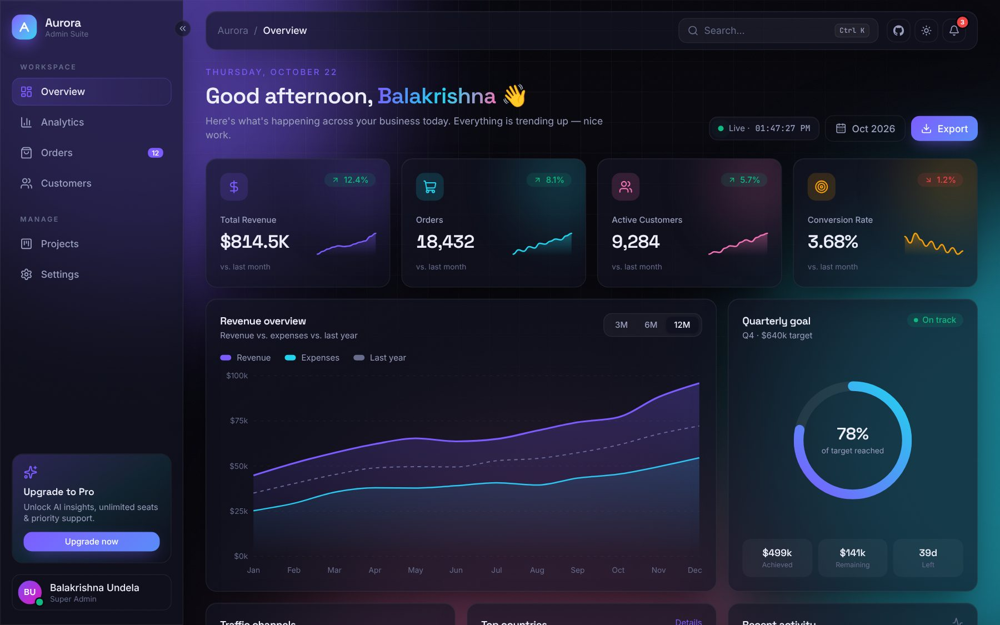
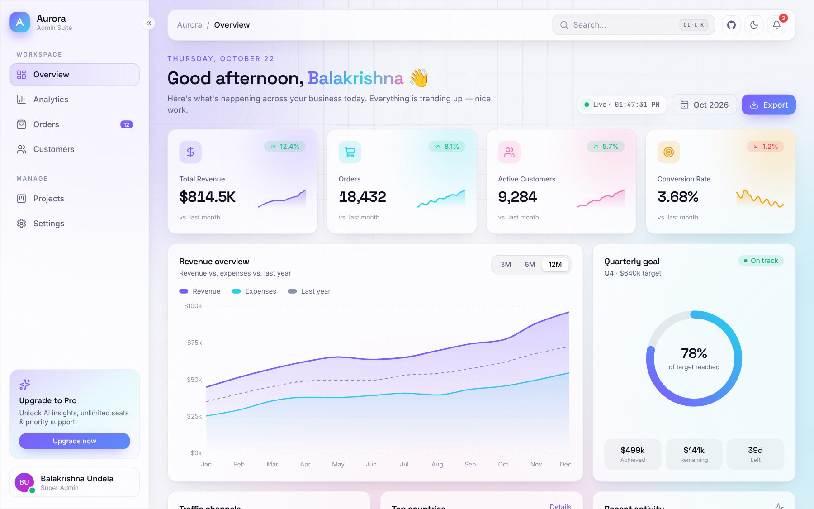
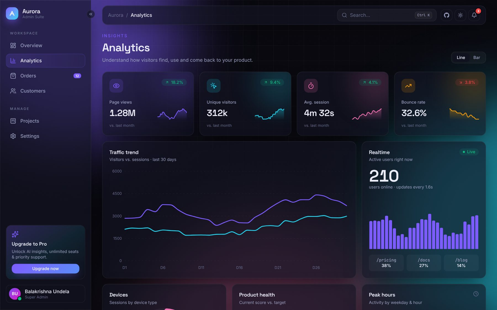
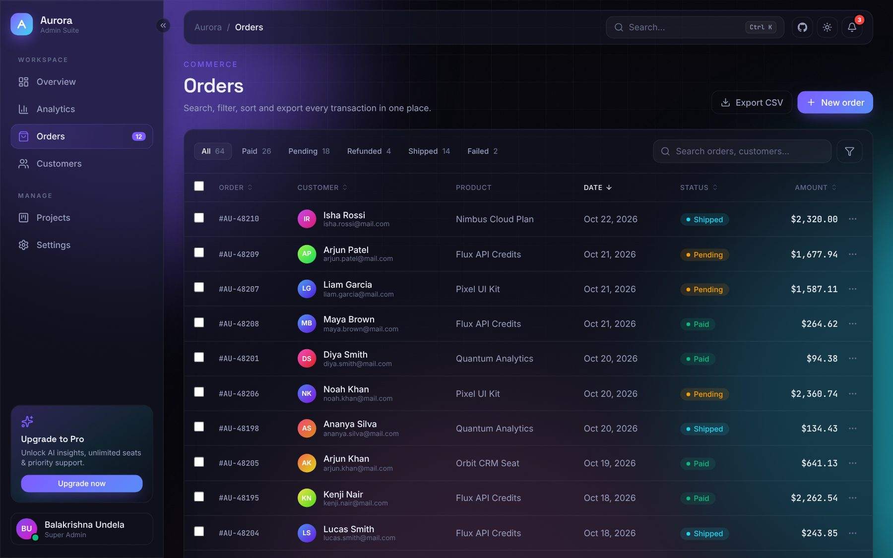
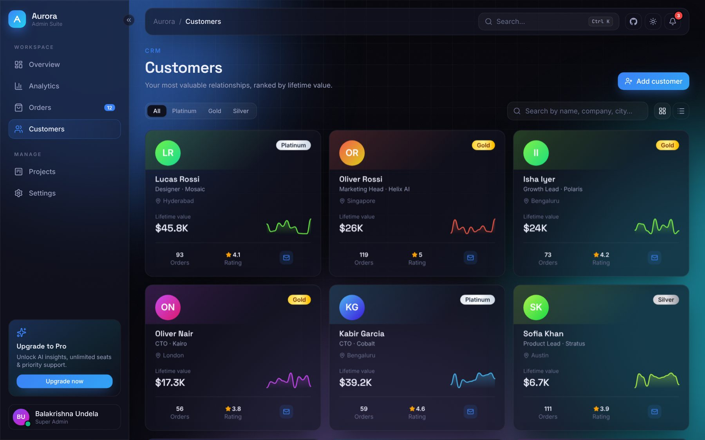
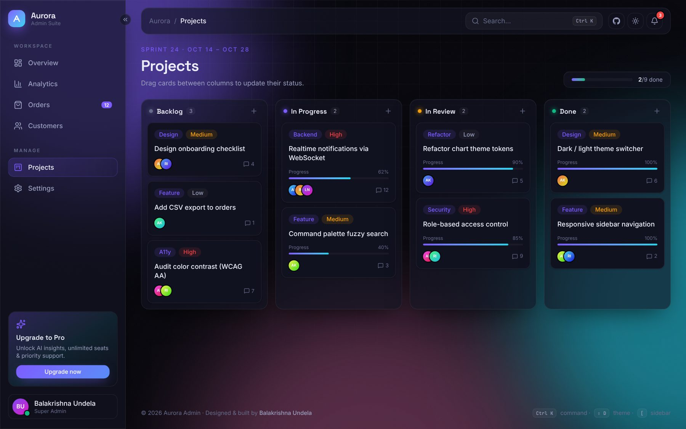
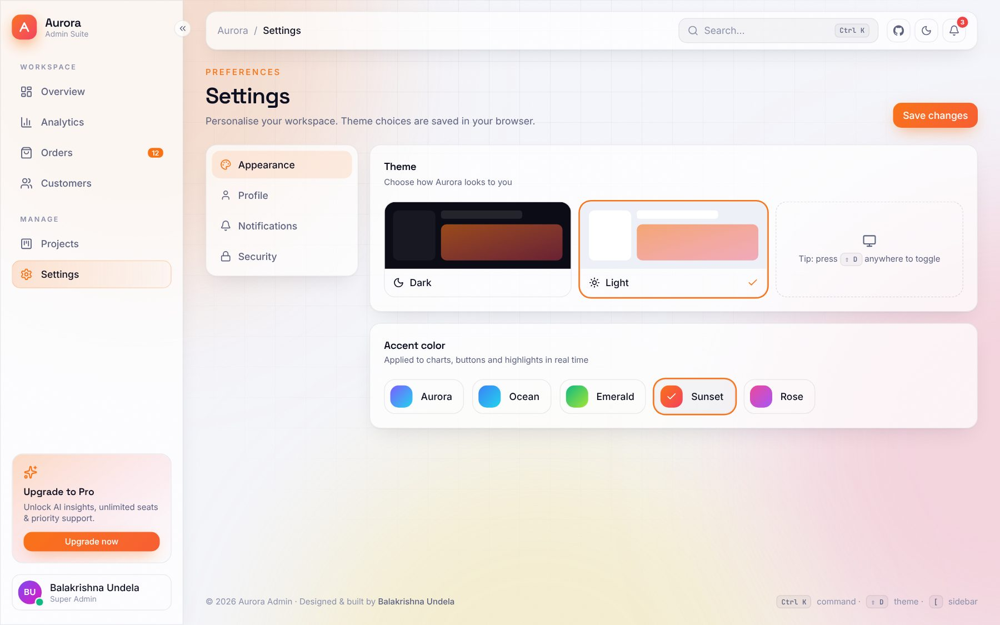
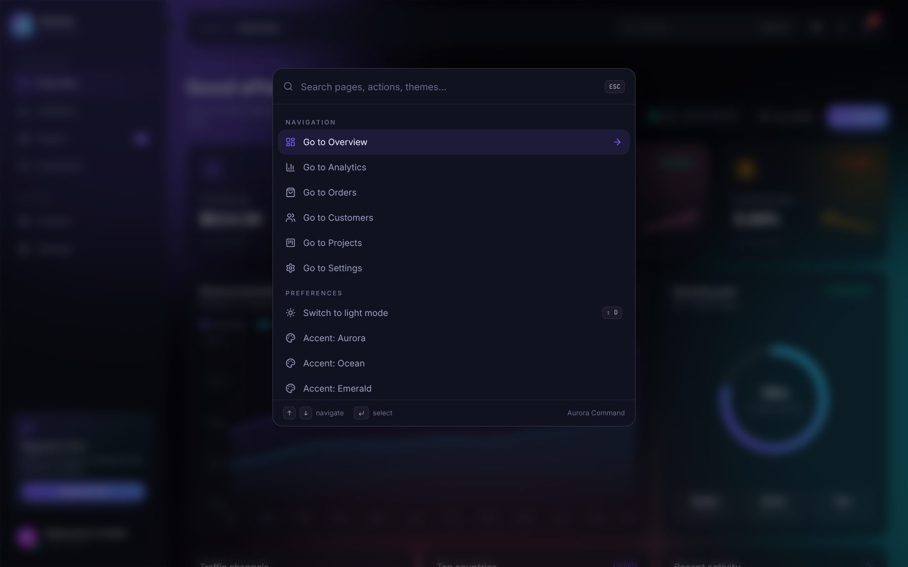
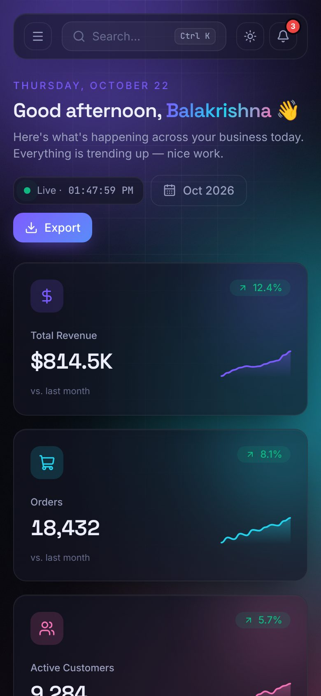

<div align="center">


# Aurora Admin

**A modern, animated admin dashboard — glassmorphism, aurora gradients, and buttery-smooth interactions.**

[](https://balakrishna-dev.github.io/admin-dashboard/)
[](https://react.dev)
[](https://www.typescriptlang.org)
[](https://tailwindcss.com)
[](https://vite.dev)

<br />



</div>

---

## ✨ Highlights

| | Feature | Details |
|---|---|---|
| 🎨 | **Living design system** | Dark & light themes plus 5 accent palettes (Aurora, Ocean, Emerald, Sunset, Rose). Every chart, button and glow re-themes instantly via CSS custom properties. |
| 🌌 | **Aurora background** | Drifting gradient blobs, a masked grid and film-grain noise — all pure CSS, GPU-friendly. |
| 🔦 | **Spotlight cards** | Glass cards with a gradient border that follows your cursor. |
| ⌨️ | **Command palette** | `Ctrl/⌘ + K` opens a fuzzy-search palette to jump between pages or switch themes — fully keyboard-driven. |
| 📊 | **Rich analytics** | Area, line, bar, donut, radial, radar charts, a 7×24 activity heatmap and a **live realtime** visitors feed. |
| 🧾 | **Data table** | Search, status tabs with counts, multi-column sorting, pagination, bulk selection, **CSV export** and a slide-over order detail drawer. |
| 🗂️ | **Kanban board** | Drag-and-drop tasks across columns with spring-animated layout transitions and inline task creation. |
| 🪪 | **3D customer cards** | Perspective-tilt cards with tier badges, sparklines and grid / list views. |
| 📱 | **Fully responsive** | Collapsible sidebar on desktop, slide-in drawer on mobile. |
| ⚡ | **Fast** | Route-level code splitting, vendor chunking and skeleton loaders. Respects `prefers-reduced-motion`. |

## 🖼️ Screenshots

<table>
  <tr>
    <td width="50%"><p align="center"><b>Overview · Light</b></p></td>
    <td width="50%"><p align="center"><b>Analytics</b></p></td>
  </tr>
  <tr>
    <td><p align="center"><b>Orders</b></p></td>
    <td><p align="center"><b>Customers · Ocean accent</b></p></td>
  </tr>
  <tr>
    <td><p align="center"><b>Projects (Kanban)</b></p></td>
    <td><p align="center"><b>Settings · Sunset accent</b></p></td>
  </tr>
  <tr>
    <td><p align="center"><b>Command palette</b></p></td>
    <td align="center"><p align="center"><b>Mobile</b></p></td>
  </tr>
</table>

## 🧱 Tech Stack

- **React 19** + **TypeScript** (strict mode)
- **Vite 7** for lightning-fast dev & builds
- **Tailwind CSS 4** with a token-based theme (`@theme` + CSS variables)
- **Recharts** for data visualisation
- **Framer Motion** for layout animations, springs and gestures
- **React Router 7** (hash routing for zero-config static hosting)
- **Lucide** icons

## 🚀 Getting Started

```bash
git clone https://github.com/balakrishna-dev/admin-dashboard.git
cd admin-dashboard
npm install
npm run dev        # http://localhost:5173
```

| Script | Description |
|---|---|
| `npm run dev` | Start the dev server with HMR |
| `npm run build` | Type-check and build for production into `dist/` |
| `npm run preview` | Preview the production build locally |
| `npm run typecheck` | Run the TypeScript compiler only |

## ⌨️ Keyboard Shortcuts

| Shortcut | Action |
|---|---|
| `Ctrl` / `⌘` + `K` | Open command palette |
| `Shift` + `D` | Toggle dark / light theme |
| `[` | Collapse / expand sidebar |
| `↑` `↓` `Enter` `Esc` | Navigate the command palette |

## 📁 Project Structure

```
src/
├── components/      # Layout, Sidebar, Topbar, CommandPalette, StatCard, UI primitives
├── data/            # Deterministic, seeded mock data
├── hooks/           # useTheme (theme + accent context), useCountUp
├── lib/             # Formatting helpers, status → tone mapping
├── pages/           # Overview, Analytics, Orders, Customers, Projects, Settings, 404
├── index.css        # Design tokens, glass / spotlight utilities, aurora background
└── main.tsx         # Router + lazy-loaded routes
```

## 🌐 Deployment

The repo ships with a GitHub Actions workflow (`.github/workflows/deploy.yml`) that builds and publishes to **GitHub Pages** on every push to `main`.

1. Go to **Settings → Pages** in the repository.
2. Under **Build and deployment**, set **Source** to **GitHub Actions**.
3. Push to `main` — your dashboard will be live at `https://<username>.github.io/admin-dashboard/`.

## 👤 Author

**Balakrishna Undela**

- GitHub: [@balakrishna-dev](https://github.com/balakrishna-dev)

If you like this project, please consider giving it a ⭐ — it really helps!

## 📄 License

Released under the [MIT License](LICENSE) © 2026 Balakrishna Undela.
